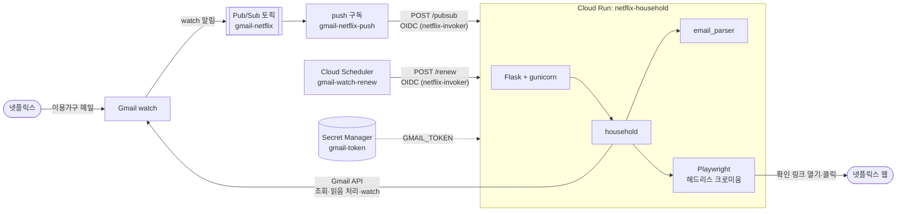
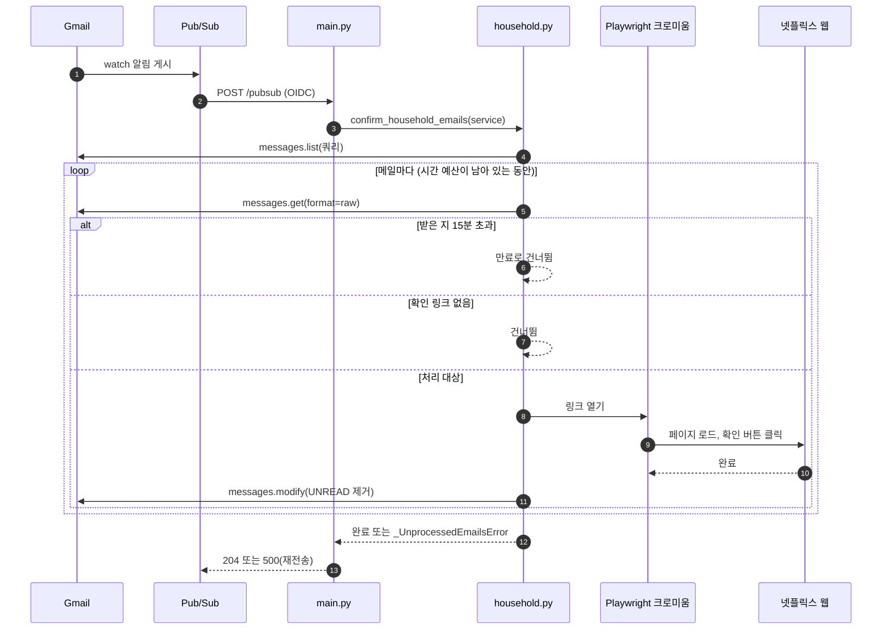
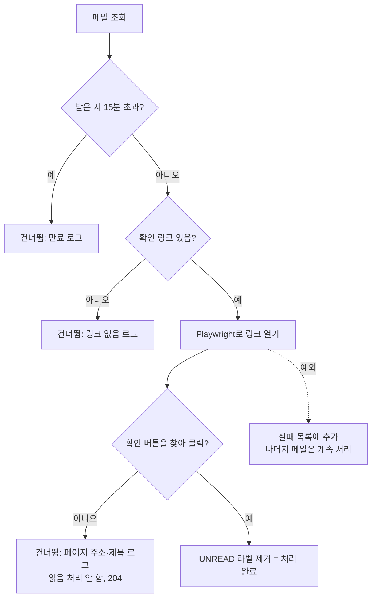
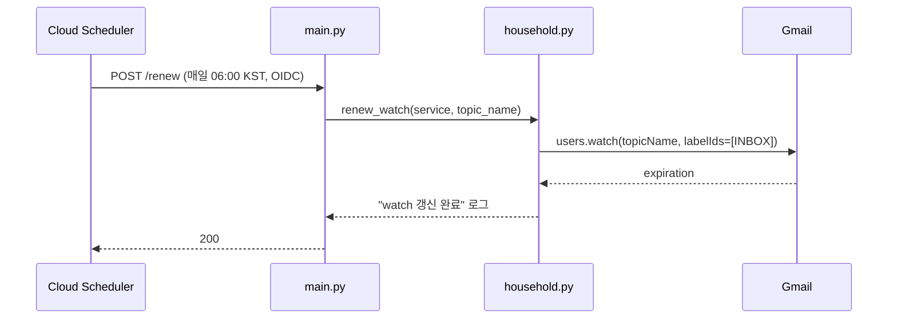
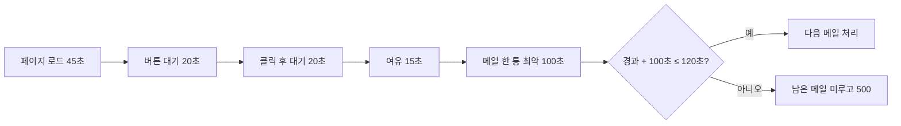

# 아키텍처 정의서

## 시스템 구성

| 구성 요소                     | 역할                                                  | 비고                                                          |
| ----------------------------- | ----------------------------------------------------- | ------------------------------------------------------------- |
| Gmail watch                   | 받은편지함에 변화가 생기면 Pub/Sub 토픽에 알림을 게시 | 7일마다 만료                                                  |
| Pub/Sub 토픽·구독             | 알림 전달과 재전송                                    | push 방식, ack 대기 120초, 메시지 보관 10분                   |
| Cloud Run                     | 알림을 받아 메일을 찾고 버튼을 클릭                   | 메모리 2Gi, CPU 1, 동시성 1, 최대 인스턴스 1, 요청 제한 120초 |
| Cloud Scheduler               | 매일 06:00(Asia/Seoul) watch 갱신 호출                | 갱신이 멈추면 알림 경로 전체가 조용히 죽음                    |
| Secret Manager                | Gmail OAuth 토큰 보관                                 | `gmail-token`을 `GMAIL_TOKEN` 환경변수로 주입                 |
| 서비스 계정 `netflix-invoker` | Pub/Sub와 Scheduler가 Cloud Run을 호출할 때의 신원    | `run.invoker` 권한만 보유                                     |

리전은 서울(`asia-northeast3`)입니다. Cloud Run은 `--no-allow-unauthenticated`로 배포해 OIDC 토큰이 없는 요청은 403으로 막습니다.

## 4. 처리 흐름

### 4.1 알림 경로 (메일 도착 시)

`confirm_household_emails()`는 Pub/Sub 메시지 본문을 파싱하지 않습니다. 알림은 단순 트리거로만 쓰고, 대상은 Gmail 쿼리 `from:netflix.com is:unread newer_than:1d`로 다시 찾습니다.

### 4.2 메일 한 통의 판단 순서

### 4.3 watch 갱신 경로

## 5. 신뢰성 설계

### 5.1 중복 방지와 재시도

| 상황                                                          | 처리                                                                                                                        | 응답                 |
| ------------------------------------------------------------- | --------------------------------------------------------------------------------------------------------------------------- | -------------------- |
| 확인 성공                                                     | `UNREAD` 라벨 제거. 읽음 처리가 곧 처리 완료 표시                                                                           | 204                  |
| 메일 한 통에서 예외(페이지 로드 시간 초과, Gmail API 오류 등) | 나머지 메일은 계속 처리하고, 끝에서 `_UnprocessedEmailsError`를 올림. 실패한 메일은 읽지 않은 채로 남아 다음 알림 때 재시도 | 500 → Pub/Sub 재전송 |
| 버튼을 찾지 못함                                              | 재시도해도 같을 가능성이 높아 그대로 끝냄                                                                                   | 204                  |
| 받은 지 15분 초과                                             | 링크가 만료됐으므로 건너뜀                                                                                                  | 204                  |
| 남은 시간 부족                                                | 남은 메일을 처리하지 않고 미룸                                                                                              | 500 → Pub/Sub 재전송 |

### 5.2 시간 예산

메일 한 통의 최악 처리 시간(`_WORST_CASE_EMAIL_DURATION`, 100초)이 요청 제한 시간(`_REQUEST_TIMEOUT`, 120초) 안에 남아 있지 않으면 남은 메일을 미룹니다. 제한 시간 도중 gunicorn이 요청을 끊으면 어느 메일까지 처리됐는지 로그가 남지 않기 때문입니다.

요청 제한 시간 120초는 다음 위치에 같은 값으로 들어 있고, 바꿀 때는 모두 함께 바꿉니다.

- `household.py`의 `_REQUEST_TIMEOUT`
- `Dockerfile`의 gunicorn `--timeout`
- `deploy.sh`의 Cloud Run `--timeout`과 Pub/Sub `--ack-deadline`
- `CLAUDE.md`의 재배포 명령 `--timeout`

재배포 명령을 뺀 나머지는 `test_household.py`가 일치를 검사합니다.
